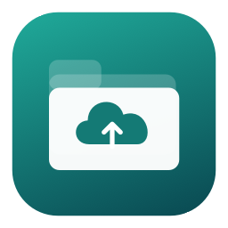
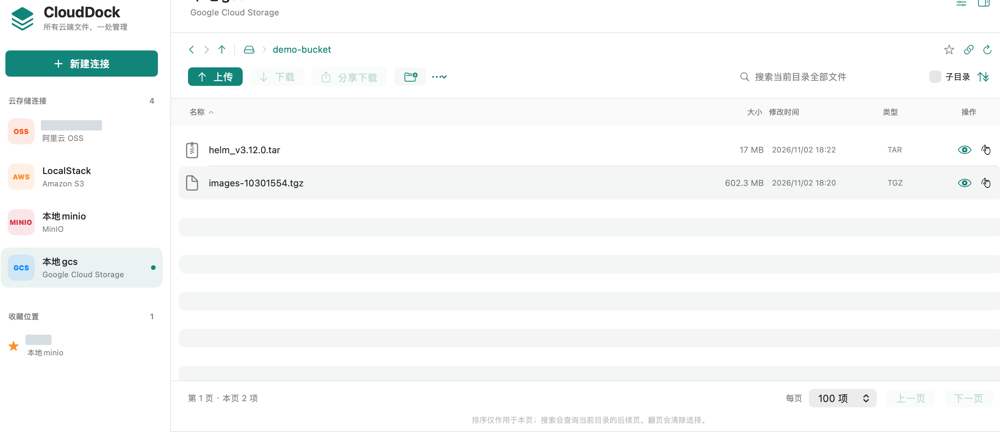
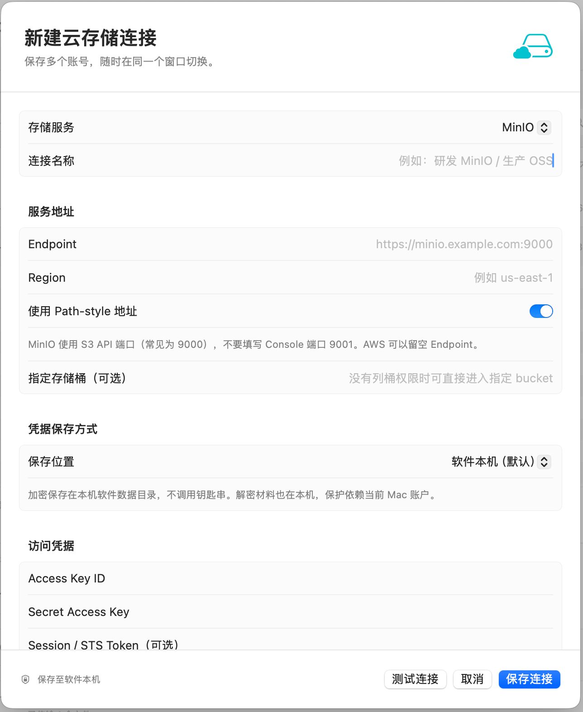
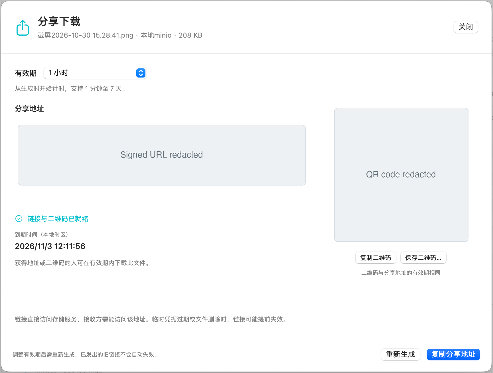
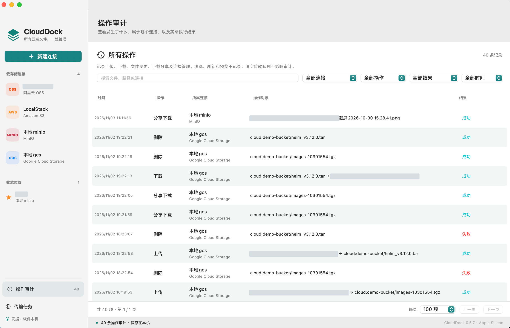

<p align="center">
  
</p>

<h1 align="center">CloudDock</h1>

<p align="center">Your cloud storage, in one place.</p>

<p align="center">
  
  
  
  <a href="LICENSE"></a>
</p>

<p align="center">
  <strong>English</strong> · <a href="README.zh-CN.md">简体中文</a>
</p>

CloudDock is a native object storage client for Apple Silicon Macs. Browse **Amazon S3, MinIO, Alibaba Cloud OSS, Google Cloud Storage, and S3-compatible services** in one window, with familiar folders, file lists, drag-and-drop transfers, and download sharing.

Built with **SwiftUI and AppKit**, with a bundled [rclone](https://rclone.org/) transfer engine. Files travel directly between your Mac and your storage service. The current app interface is **Simplified Chinese**; documentation is available in English and Chinese.

[Download for Apple Silicon](https://github.com/zealerFT/clouddock/releases/latest) · [Build from source](#build-from-source) · [Changelog](CHANGELOG.md) · [Report a bug](https://github.com/zealerFT/clouddock/issues)



*The file workspace on macOS. [More screenshots](#screenshots) below.*

## Features

- **One workspace for multiple accounts.** Switch connections from the sidebar, browse buckets and folders, and bookmark frequently used locations.
- **Drag-and-drop transfers.** Drop files or folders into the app to upload. Drag a row's download handle into Finder, or select multiple items and use Download.
- **Review overwrites.** Choose Skip, Overwrite, or Cancel when names conflict. The queue distinguishes completed, skipped, and partially skipped operations.
- **Browse large directories.** File lists and operation history are paginated. Search can continue across pages and optionally include subfolders; sorting applies to the current page.
- **Preview small files.** Double-click supported text, image, or PDF files to preview them before downloading.
- **Share downloads.** Create links with preset or custom validity, copy the address in one click, and copy or save a QR code.
- **Track changes across connections.** Local operation history records transfers, file changes, generated shares, and connection management, with filters by connection, action, result, and time.
- **Choose credential storage.** Keep credentials encrypted locally, or opt into macOS Keychain for each connection.

## Screenshots

Actual macOS app captures with a Simplified Chinese interface. Private identifiers and share data are redacted. [Capture details](docs/screenshots/README.md).

**Connection settings** — choose a provider, configure its endpoint, and select where credentials are stored.



**Share downloads** — set an expiry, copy the download address, or copy/save a QR code. The signed address and QR content are hidden in this capture.



**Operation history** — review actions across connections, filter the results, and browse records by page.



## Requirements

| Requirement | Details |
| --- | --- |
| Hardware | Apple Silicon Mac, including M3; native `arm64` packages |
| Operating system | macOS 14 or later |
| App language | Simplified Chinese |
| Building from source | Compatible Xcode or Command Line Tools with Swift 5.9+, plus Python 3 |
| Network | Access to the storage endpoints you configure |

Release packages are built on GitHub's Apple Silicon macOS runners. Not every supported macOS version or Apple Silicon model has been tested. Intel packages are not provided.

## Installation

### Packaged app

1. Open [GitHub Releases](https://github.com/zealerFT/clouddock/releases) and download `CloudDock-<version>-arm64.dmg`.
2. Open the disk image and drag **CloudDock.app** into **Applications**.
3. Open **CloudDock**, then click **新建连接** (New Connection).

A ZIP containing the app is also available in each release. The `-source.zip` archive and GitHub's **Source code** downloads are for developers, not installers. Downloads include a `SHA256SUMS` file for verifying the installers.

Quit CloudDock before updating, then replace it in its existing location. Keep one installed copy to avoid duplicate entries in Spotlight. Connections and history are stored separately from the app bundle.

Current packages use an **ad-hoc signature** and are **not notarized by Apple**. If macOS blocks a download you trust, try opening it once, then look for **System Settings → Privacy & Security → Open Anyway**. Building from source is also supported.

### Build from source

On an Apple Silicon Mac with the tools above installed:

```bash
git clone https://github.com/zealerFT/clouddock.git
cd clouddock
python3 scripts/fetch-rclone.py
swift run CloudDockChecks
bash scripts/package.sh
```

The fetch script downloads **rclone 1.75.2** for macOS ARM64 and verifies a pinned SHA-256 checksum. No global rclone installation is needed. Packaging compiles the app, generates its icon, signs and verifies the bundle, and creates:

```text
dist/CloudDock.app
dist/CloudDock-0.5.10-arm64.dmg
dist/CloudDock-0.5.10-arm64.zip
dist/CloudDock-0.5.10-source.zip
dist/SHA256SUMS
```

If `dist/CloudDock.app` is running, packaging prepares the archives and leaves that bundle unchanged. Quit it and run `python3 scripts/install-local.py` to replace it in place. To run directly from source, use `swift run CloudDock` after fetching rclone.

## Connect a storage service

| Service | Connection settings |
| --- | --- |
| MinIO | S3 API endpoint and access/secret keys. Use the API port, commonly `9000`, rather than the console port, commonly `9001`. Path-style addressing is enabled by default. |
| Amazon S3 | Region and access/secret keys; an optional session token. Leave Endpoint blank for the AWS endpoint. |
| Alibaba Cloud OSS | Regional endpoint, region, and access/secret keys; an optional STS token. Do not include a bucket prefix in the endpoint; virtual-host addressing is normally appropriate. |
| Google Cloud Storage | Service-account JSON containing `client_email` and `private_key`. Leave Endpoint blank for Google; set the numeric project number when listing buckets. |
| S3-compatible service | Custom endpoint, region, access/secret keys, and addressing mode. Compatibility depends on the service's API implementation. |
| LocalStack | Choose Amazon S3. A typical setup is `http://localhost:4566`, `test` / `test`, and the region used to create the bucket. The app still expects nonempty test credentials. |
| fake-gcs-server | Choose Google Cloud Storage. Use `http://localhost:4443/storage/v1/`, project number `0`, and no JSON key. |

Specify a bucket to open it directly when the account cannot list all buckets. Localhost and IP endpoints use path-style routing where needed; saved local GCS endpoints without the JSON API suffix are normalized at request time.

**Test Connection checks listing access only.** Upload, delete, and share operations depend on account permissions. fake-gcs-server is a community emulator, not an official Google image, and does not validate real Google authentication or IAM behavior.

## Everyday use

1. Select a connection, then open a bucket and folder. The entire connection row is clickable; its context menu edits that connection.
2. Upload using **上传**, or drop files and folders into the file area. Review the conflict prompt if names already exist.
3. Use **下载** for selected items, or drag the handle in the **操作** column into Finder.
4. Double-click a file to preview it, or right-click for details, rename, share, and delete actions.
5. Star a location to bookmark it. Open **操作审计** (Operation History) to inspect results across connections.

### Download sharing

Select one file and choose **分享下载** (Share Download). Presets include 15 minutes, 1 hour, 1 day, and 7 days; custom durations range from **1 minute to 7 days**. Generate and copy a link in one step, or copy/save its QR code separately.

- S3, MinIO, OSS, and compatible services use signed download links. Google Cloud Storage uses a V4 URL signed with the service-account private key.
- Changing the duration requires a new link. Previously issued links are not revoked; credentials, permissions, or file deletion can make them stop working earlier.
- Local fake-gcs-server connections produce **direct links with no enforced expiry**, labeled accordingly. A localhost link cannot be opened from another computer or phone.
- QR codes are generated on your Mac and contain the complete link. No external QR-code service or URL shortener is used.
- Generating a share is recorded in local history; the link and QR code are not stored there. Opening the dialog or copying its result does not create another record.

### Previews and operation history

| Feature | Behavior |
| --- | --- |
| Text preview | Up to 1 MiB; UTF-8 and UTF-16 with a byte-order mark |
| Image / PDF preview | Up to 10 MiB; PDFs must be unencrypted and at most 200 pages |
| HTML, Markdown, scripts | Displayed as plain text, not executed |
| Unsupported or larger files | Download to open in another app |
| History | Uploads, downloads, file changes, generated shares, and connection creation/editing/removal |
| Read-only actions | Browsing, refresh, search, and preview are not logged |

Previews are bounded reads displayed in memory. History survives restarts and clearing completed transfers; it records activity from this app, not operations performed by other clients.

## Credentials and local data

New connections default to **软件本机** (Local App Storage). Credentials are encrypted with AES-GCM, with restricted directory/file permissions. **The encryption key is stored locally too**, so protection depends on your macOS account and filesystem access. Back up the complete `Credentials` directory if you need to preserve them.

Choose **macOS 钥匙串** (macOS Keychain) for system-managed storage instead. Keychain can prompt for authorization, especially after an ad-hoc signed app is updated. Opening the connection editor does not automatically read credentials; use **读取已保存凭据** (Load Saved Credentials) or enter replacement values.

When the provider and storage mode are unchanged, leaving all credential fields blank preserves the saved credentials. Switching storage modes requires loading or entering them first.

```text
~/Library/Application Support/CloudDock/
├── state.json                 Connections, favorites, and transfer records
├── Credentials/               Locally encrypted credentials and encryption key
├── audit.jsonl                Local operation history
└── audit.jsonl.index.sqlite    Rebuildable index for history pagination
```

CloudDock does not add a hosted account or file relay. State and history can contain endpoint addresses, connection names, filenames, and local paths. Review those details before sharing logs or screenshots; do not attach credentials or signed download links to public issues.

## Development and testing

```text
Sources/CloudDock/            SwiftUI interface and AppKit integration
Sources/CloudDockCore/        Storage protocols, transfers, credentials, and history
Tests/CloudDockCoreTests/     Standalone checks and local integration fixtures
scripts/                     Dependency fetching, packaging, and test runners
docs/                        Public assets, release notes, and development guides
```

Run `swift run CloudDockChecks` without cloud credentials. Integration checks skip when their fixtures are absent. To run the isolated Moto S3 suite:

```bash
python3 -m venv .qa-venv
.qa-venv/bin/python -m pip install -r requirements-qa.txt
python3 scripts/integration-test.py
```

Additional provider checks use Podman:

```bash
# Requires the MinIO and LocalStack ARM64 images listed in the script to be cached.
python3 scripts/local-s3-integration-test.py

# Starts and removes a disposable fake-gcs-server container.
python3 scripts/local-gcs-integration-test.py

# Or reuse a running local emulator; only a unique test bucket is created/removed.
python3 scripts/local-gcs-integration-test.py --endpoint http://localhost:4443
```

Checks cover pagination, Unicode/space/plus-sign object names, transfer bytes, overwrite choices, preview limits, credentials, history, and share URLs. Google V4 signing and QR contents are checked locally. Emulator tests do not establish real AWS, Alibaba Cloud, or Google Cloud account permissions; Finder drag-and-drop and system authorization dialogs also need manual testing.

## Current limitations

- Folders are object-key prefixes. Renaming uses copy-and-delete behavior and is not an atomic transaction.
- Pausing and resuming work while the app runs. Interrupted transfers can be retried after restarting; multipart uploads are not guaranteed to resume from the interrupted byte.
- Sorting applies to the current page. Search matches names and paths, not file contents.
- No cross-cloud copy, synchronization, version-history browser, ACL/lifecycle editor, AWS SSO, Google browser OAuth, automatic token renewal, or automatic app updates.
- Sharing supports single files, not folders. Signed-link support varies among S3-compatible services.
- Symbolic links are not followed on upload. Remote paths containing `.`, `..`, empty segments, or backslashes are not supported.

## Contributing

Bug reports and focused pull requests are welcome. Include the app version, macOS version, chip, provider, reproduction steps, and exact error message. Use disposable buckets when reproducing uploads or deletions, and redact private data from logs and screenshots.

Continue development in the Git checkout; see the [development guide](docs/DEVELOPMENT.md). Changes to storage behavior should include checks using local fixtures. The [publishing guide](docs/PUBLISHING.md) explains version tags and automated GitHub Releases.

## License

[MIT](LICENSE) © 2026 zealerFT.

CloudDock bundles rclone, which has its own license and notices. See [THIRD_PARTY_NOTICES.txt](THIRD_PARTY_NOTICES.txt).
