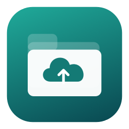

<p align="center">
  
</p>

<h1 align="center">CloudDock</h1>

<p align="center">所有云端文件，一处管理。</p>

<p align="center">
  
  
  
  <a href="LICENSE"></a>
</p>

<p align="center">
  <a href="README.md">English</a> · <strong>简体中文</strong>
</p>

CloudDock 是为 Apple Silicon Mac 开发的原生对象存储客户端。在一个窗口中管理 **Amazon S3、MinIO、阿里云 OSS、Google Cloud Storage 和 S3 兼容服务**，通过熟悉的文件夹与文件列表浏览内容、拖拽传输和分享下载。

应用使用 **SwiftUI + AppKit**，内置 [rclone](https://rclone.org/) 作为传输引擎。文件直接在你的 Mac 与存储服务之间传输。当前应用界面为**简体中文**，仓库提供英文和中文文档。

[下载 Apple Silicon 安装包](https://github.com/zealerFT/clouddock/releases/latest) · [从源码构建](#从源码构建) · [更新记录](CHANGELOG.md) · [反馈问题](https://github.com/zealerFT/clouddock/issues)

## 功能

- **一个工作台，多个云账号**：在侧栏切换连接，浏览存储桶和文件夹，收藏常用位置。
- **拖拽上传与下载**：把文件或文件夹拖入应用上传；把文件行的下载手柄拖到 Finder 下载，也可多选后点击下载。
- **明确处理同名文件**：遇到冲突时选择跳过、覆盖或取消；队列区分完成、跳过和部分跳过。
- **按页浏览大量文件**：文件列表和操作审计均支持分页；搜索可跨页并包含子目录，排序作用于当前页。
- **小文件预览**：双击支持的文本、图片或 PDF，在下载前查看内容。
- **分享下载**：设置预设或自定义有效期，一键复制链接，复制或保存二维码。
- **跨连接操作审计**：记录传输、文件变更、生成分享和连接管理，可按连接、操作、结果和时间筛选。
- **选择凭据保存方式**：每个连接可使用本机加密存储，或选择 macOS 钥匙串。

## 系统要求

| 项目 | 要求 |
| --- | --- |
| 硬件 | Apple Silicon Mac，包含 M3；原生 `arm64` 安装包 |
| 操作系统 | macOS 14 及以上 |
| 应用语言 | 简体中文 |
| 源码构建 | 提供 Swift 5.9+ 的兼容 Xcode 或 Command Line Tools，以及 Python 3 |
| 网络 | 可访问配置的存储服务地址 |

发布包由 GitHub 的 Apple Silicon macOS runner 构建。尚未覆盖所有支持的 macOS 版本和 Apple Silicon 机型的实机测试，不提供 Intel 安装包。

## 安装

### 安装包

1. 打开 [GitHub Releases](https://github.com/zealerFT/clouddock/releases)，下载 `CloudDock-<版本>-arm64.dmg`。
2. 打开磁盘映像，将 **CloudDock.app** 拖入「**应用程序**」。
3. 打开 **CloudDock**，点击「**新建连接**」。

每个 Release 同时提供包含应用的 ZIP。`-source.zip` 和 GitHub 自动生成的 **Source code** 是开发者源码，不是安装包。下载文件附带 `SHA256SUMS`，用于核验安装包。

升级前退出 CloudDock，在原位置替换应用。只保留一份安装副本，可避免 Spotlight 出现重名应用。连接和历史记录保存在应用包之外。

当前安装包使用 **ad-hoc 本地签名**，**尚未经过 Apple 公证**。如果 macOS 阻止打开你信任的下载，可先尝试打开一次，再到「系统设置 → 隐私与安全性」查看是否提供「仍要打开」。也支持自行构建源码。

### 从源码构建

在已安装上述工具的 Apple Silicon Mac 上执行：

```bash
git clone https://github.com/zealerFT/clouddock.git
cd clouddock
python3 scripts/fetch-rclone.py
swift run CloudDockChecks
bash scripts/package.sh
```

下载脚本获取 macOS ARM64 版 **rclone 1.75.2**，并与固定的 SHA-256 校验值核对，无需全局安装 rclone。打包脚本会编译应用、生成图标、签名并校验应用包，输出：

```text
dist/CloudDock.app
dist/CloudDock-0.5.7-arm64.dmg
dist/CloudDock-0.5.7-arm64.zip
dist/CloudDock-0.5.7-source.zip
dist/SHA256SUMS
```

如果 `dist/CloudDock.app` 正在运行，脚本会生成安装包并保留运行中的应用。退出后执行 `python3 scripts/install-local.py` 即可原位更新。开发时也可在下载 rclone 后执行 `swift run CloudDock`。

## 连接存储服务

| 服务 | 配置方式 |
| --- | --- |
| MinIO | S3 API Endpoint 和 AK/SK。使用 API 端口，通常为 `9000`，不要使用通常为 `9001` 的 Console 端口。默认启用 Path-style。 |
| Amazon S3 | Region、AK/SK，可选 Session Token；Endpoint 留空使用 AWS 地址。 |
| 阿里云 OSS | 区域 Endpoint、Region、AK/SK，可选 STS Token。Endpoint 不含 bucket 前缀，通常使用 virtual-host 地址模式。 |
| Google Cloud Storage | 包含 `client_email` 和 `private_key` 的服务账号 JSON；Endpoint 留空使用 Google，列举存储桶时填写数字项目编号。 |
| S3 兼容服务 | 自定义 Endpoint、Region、AK/SK 和地址模式；兼容性取决于服务的 API 实现。 |
| LocalStack | 选择 Amazon S3。常见配置为 `http://localhost:4566`、`test` / `test`，Region 与建桶时一致。应用仍要求填写非空测试凭据。 |
| fake-gcs-server | 选择 Google Cloud Storage，填写 `http://localhost:4443/storage/v1/`、项目编号 `0`，无需 JSON 密钥。 |

如果账号没有列举所有存储桶的权限，可指定 bucket 直接进入。localhost 或 IP Endpoint 会按需自动使用 Path-style；旧的本地 GCS 裸地址会在请求时自动补全 API 路径。

**测试连接仅验证读取列表的权限。** 上传、删除、分享仍受账号权限限制。fake-gcs-server 是社区模拟器，不是 Google 官方镜像，也不验证真实 Google 鉴权或 IAM 行为。

## 日常使用

1. 选择连接，进入存储桶和文件夹。连接整行均可点击，右键菜单对应当前点击的那条连接。
2. 点击「**上传**」，或拖入文件和文件夹；遇到同名文件时核对冲突提示。
3. 对选中项点击「**下载**」，也可将「**操作**」列的下载手柄拖到 Finder。
4. 双击文件预览；右键可查看详情、重命名、分享或删除。
5. 点击星标收藏位置。在「**操作审计**」中查看不同连接的操作结果。

### 分享下载

选中单个文件，选择「**分享下载**」。预设有效期包含 15 分钟、1 小时、1 天和 7 天，也可自定义 **1 分钟至 7 天**的时长。可一步生成并复制地址，也可单独复制或保存二维码。

- S3、MinIO、OSS 和兼容服务使用签名下载链接；Google Cloud Storage 使用服务账号私钥生成 V4 签名链接。
- 修改时长后需要重新生成，已经发出的旧链接不会被撤销。凭据过期、权限变化或文件删除可能使链接提前失效。
- 本地 fake-gcs-server 提供的是**无自动过期的下载直链**，界面会明确标注。localhost 链接不能由另一台电脑或手机访问。
- 二维码在本机生成，内容是完整下载链接，不使用外部二维码服务或短链服务。
- 生成分享会记入本地审计，但不保存分享地址或二维码；打开窗口、复制结果不重复记录。

### 预览与操作审计

| 功能 | 行为 |
| --- | --- |
| 文本预览 | 最大 1 MiB；支持 UTF-8 和带字节序标记的 UTF-16 |
| 图片 / PDF 预览 | 最大 10 MiB；PDF 不能加密，且最多 200 页 |
| HTML、Markdown、脚本 | 以纯文本显示，不执行 |
| 其他类型或较大文件 | 下载后使用其他应用打开 |
| 审计范围 | 上传、下载、文件变更、生成分享，以及新增、编辑和移除连接 |
| 只读操作 | 浏览、刷新、搜索和预览不记录 |

预览只做限量读取并在内存中显示。重启应用或清空传输队列不会清除审计。审计仅记录本应用执行的操作，不包含其他客户端的行为。

## 凭据与本机数据

新连接默认使用「**软件本机**」。凭据通过 AES-GCM 加密，目录与文件权限受到限制。**加密密钥也保存在本机**，保护依赖 macOS 账户和文件系统访问权限。需要备份凭据时，应保留完整的 `Credentials` 目录。

也可以选择「**macOS 钥匙串**」，由系统保存凭据。钥匙串可能请求授权，特别是在 ad-hoc 签名应用更新后。打开编辑窗口不会自动读取凭据；可点击「**读取已保存凭据**」，或重新填写。

服务类型和保存方式不变时，凭据字段全部留空会保留原凭据。切换保存方式前，需要先读取或重新填写凭据。

```text
~/Library/Application Support/CloudDock/
├── state.json                 连接、收藏和传输记录
├── Credentials/               本机加密凭据及加密密钥
├── audit.jsonl                本地操作审计
└── audit.jsonl.index.sqlite    用于分页、可重建的审计索引
```

CloudDock 不提供额外的托管账户或文件中转服务。状态文件和审计可能含 Endpoint、连接名称、文件名和本机路径。公开日志或截图前请检查这些信息，不要向公开 Issue 上传凭据或签名下载链接。

## 开发与测试

```text
Sources/CloudDock/            SwiftUI 界面与 AppKit 集成
Sources/CloudDockCore/        存储协议、传输、凭据与审计
Tests/CloudDockCoreTests/     独立检查程序和本地集成夹具
scripts/                     依赖下载、打包与测试脚本
docs/                        公开素材、版本说明与开发指南
```

执行 `swift run CloudDockChecks` 无需云端凭据。未提供对应夹具时，集成检查会跳过。运行隔离的 Moto S3 集成测试：

```bash
python3 -m venv .qa-venv
.qa-venv/bin/python -m pip install -r requirements-qa.txt
python3 scripts/integration-test.py
```

其他存储兼容性检查使用 Podman：

```bash
# 需提前缓存脚本中指定的 MinIO 和 LocalStack ARM64 镜像。
python3 scripts/local-s3-integration-test.py

# 启动并清理临时 fake-gcs-server 容器。
python3 scripts/local-gcs-integration-test.py

# 或复用运行中的本地模拟器，只创建并清理唯一测试桶。
python3 scripts/local-gcs-integration-test.py --endpoint http://localhost:4443
```

检查覆盖分页、中文/空格/加号对象名、传输字节、覆盖选择、预览限制、凭据、审计和分享链接。Google V4 签名与二维码内容有本地校验。模拟器测试不能代替真实 AWS、阿里云或 Google Cloud 的账号权限验证；Finder 拖放和系统授权弹窗也需要人工验收。

## 当前限制

- 文件夹是对象 key 前缀。重命名通过复制后删除完成，不是原子事务。
- 暂停和继续只在应用运行时有效。重启后可重试中断任务，不保证分片上传从中断字节处续传。
- 排序作用于当前页；搜索匹配名称和路径，不搜索文件内容。
- 不包含跨云复制、同步、版本历史浏览、ACL/生命周期编辑、AWS SSO、Google 浏览器 OAuth、自动续期凭据或应用自动更新。
- 分享仅支持单个文件，不支持文件夹；S3 兼容服务对签名链接的支持可能不同。
- 上传不跟随符号链接；不支持含 `.`、`..`、空段或反斜杠的远程路径。

## 应用截图

实际应用截图尚待补充，截图说明及计划展示的页面见 [docs/screenshots](docs/screenshots/README.md)。

## 参与贡献

欢迎提交 Bug 和范围明确的 Pull Request。反馈时请提供应用版本、macOS 版本、芯片、服务类型、复现步骤和完整报错。上传或删除测试应使用独立测试桶，日志和截图中的私人信息请先脱敏。

后续开发直接在 Git checkout 中完成，流程见[开发指南](docs/DEVELOPMENT.md)。存储行为变更应附带本地夹具检查；版本 tag 和 GitHub 自动发版流程见[发布指南](docs/PUBLISHING.md)。

## 许可证

[MIT](LICENSE) © 2026 zealerFT。

内置 rclone 使用其自身许可证及声明，见 [THIRD_PARTY_NOTICES.txt](THIRD_PARTY_NOTICES.txt)。
